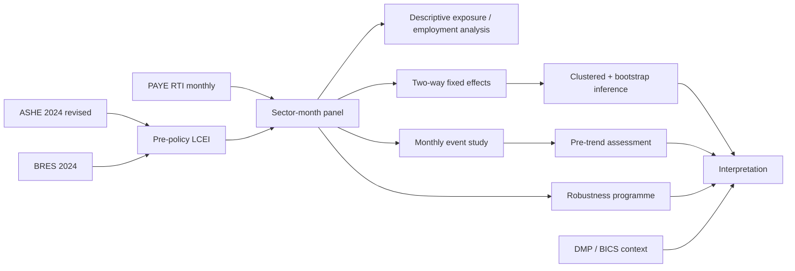

# Analysis workflow

## Stage 1 — Exposure construction

The index is fixed with 2024 information only. Median-pay proximity, P10 exposure and BRES part-time intensity are standardised and equally weighted.

## Stage 2 — Outcome panel

Seasonally adjusted PAYE employment is extracted for SIC A-S for every month from January 2023 through July 2026 and merged one-to-many with the fixed sector LCEI.

## Stage 3 — Primary model

The baseline estimates sector fixed effects, month fixed effects and the interaction between final LCEI and an April-2025-onward indicator. Standard errors are clustered by sector.

## Stage 4 — Dynamic analysis

The event study replaces the single post interaction with monthly exposure-by-event-time interactions. March 2025 is omitted as the reference month.

## Stage 5 — Diagnostics and robustness

Pre-policy tests, residual diagnostics, wild-cluster bootstrap, alternative covariances, alternative exposure definitions, timing windows, weights, sector trends, growth outcomes and leave-one-sector-out estimates are retained.

## Stage 6 — Interpretation

The primary result is interpreted together with uncertainty and design limitations. DMP and BICS are used as contextual triangulation for other adjustment margins, not as regression observations.
